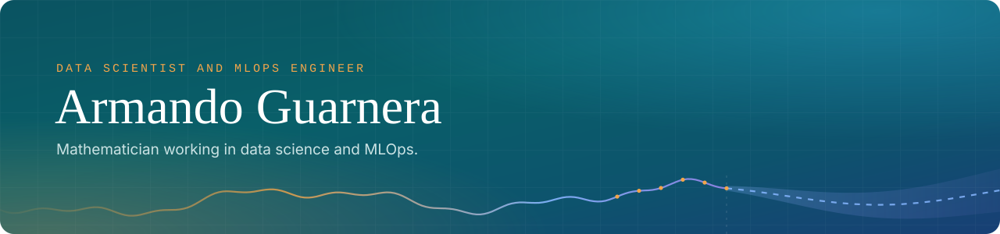
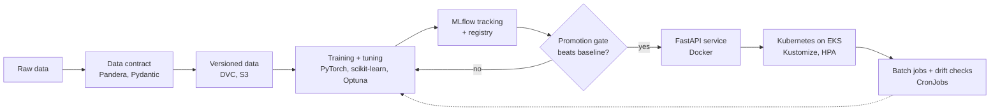

  

     

---

## About

I'm a mathematician (**B.S. in Mathematics**, specialisation in Probability, Statistics and Mathematical Modelling) working as a **data scientist and MLOps engineer**. I build predictive models and the systems around them: versioned data, tracked experiments, promotion gates, containerised APIs on Kubernetes and drift monitoring.

Every project below is evaluated on **held-out data the model never saw** and comes with a written case study that explains each decision, including the shortcuts I chose not to take. Most use real-world data; the salary and grocery projects use public simulated datasets, and their write-ups say so.

**How I work**

| | |
| :--- | :--- |
| **Beat the obvious baseline** | Every model is measured against the simplest thing that could work: the last reading, the majority class, a naive guess. If it does not clearly beat it, it does not ship. |
| **Leakage-free by construction** | Splits by engine, customer or time. Transformations fitted inside the pipeline. Features limited to what exists at prediction time. |
| **Evaluate against the future** | Held-out years, unseen engines, time-based windows. I report the honest score, even when it is the modest one. |
| **Operate, don't just train** | Data and models versioned, promotion gates in a registry, services on Kubernetes and drift checks once the model is live. |

---

## Production ML systems

Three end-to-end MLOps projects that share the same lifecycle:

| Project | Problem | Result on held-out data | Stack |
| :--- | :--- | :--- | :--- |
| [**Transformer oil temperature**](https://github.com/arguar13/Transformer-Oil-Temperature-MLOps) | 48-hour forecasts for a power transformer, promoted only if they beat the last reading | **1.72 °C** MAE on 3,389 unseen windows, **+5.8%** skill vs persistence | PyTorch: Optuna, DVC, MLflow, FastAPI, Kubernetes, Terraform, AWS, GitLab CI |
| [**Turbofan predictive maintenance**](https://github.com/arguar13/Turbofan-Predictive-Maintenance-MLOps) | Healthy, Alert or Critical from the last 30 flight cycles of NASA turbofan data | **88.4%** of Critical windows caught, **0.831** macro F1 on 142 unseen engines | PyTorch: Pandera, DVC, MLflow, FastAPI, Kubernetes, Terraform, GitLab CI, GitHub Actions |
| [**Hotel market-segment classifier**](https://github.com/arguar13/Hotel-Booking-MLOps) | Segment classifier with a feature contract, two promotion gates and daily drift monitoring | **0.818** macro F1 on test, **0.653** on 2017, a year it never saw | scikit-learn, Optuna, DVC, MLflow, FastAPI, PostgreSQL, Streamlit, Kubernetes, Terraform |

**Infrastructure behind them:** local first, then the cloud. Every change runs against Docker Compose and LocalStack before it reaches AWS, so most errors show up on the laptop instead of in a paid environment. All three were then deployed end to end on a real AWS account with Terraform (S3, ECR, EKS, RDS PostgreSQL, IAM with OIDC for CI, CloudWatch) and torn down afterwards to avoid running costs. CI/CD runs in GitLab CI, with quality checks in pytest, ruff, mypy and pre-commit.

---

## More case studies

<table>
  <tr>
    <th align="left">Area</th><th align="left">Project</th><th align="left">Result</th><th align="left">Tools</th>
  </tr>
  <tr>
    <td>Deep learning</td>
    <td><a href="https://github.com/arguar13/Vehicle-Image-Classification">Seven-class vehicle image classification</a></td>
    <td><b>0.969</b> macro F1 on unseen images</td>
    <td>PyTorch, torchvision, transfer learning</td>
  </tr>
  <tr>
    <td>Deep learning</td>
    <td><a href="https://github.com/arguar13/Turbofan-Predictive-Maintenance">Turbofan engine health from 30 flights</a></td>
    <td><b>0.79</b> macro F1 on unseen engines</td>
    <td>PyTorch, multivariate time series</td>
  </tr>
  <tr>
    <td>Deep learning</td>
    <td><a href="https://github.com/arguar13/Transformer-Oil-Temperature-Forecasting">One-hour transformer oil temperature</a></td>
    <td><b>0.436 °C</b> MAE, five architectures vs the last reading</td>
    <td>PyTorch, Optuna</td>
  </tr>
  <tr>
    <td>Machine learning</td>
    <td><a href="https://github.com/arguar13/AI4I-Predictive-Maintenance">Catching machine failures before they happen</a></td>
    <td><b>46 of 51</b> failures caught on test</td>
    <td>XGBoost, LightGBM, CatBoost, Optuna</td>
  </tr>
  <tr>
    <td>Machine learning</td>
    <td><a href="https://github.com/arguar13/Employee-Salary-Prediction">Salary prediction from 250,000 profiles</a></td>
    <td><b>0.981</b> R² on 50,000 unseen records</td>
    <td>scikit-learn, XGBoost, LightGBM, Optuna</td>
  </tr>
  <tr>
    <td>Machine learning</td>
    <td><a href="https://github.com/arguar13/Hotel-Booking-Segment-Classification">Hotel booking market segments</a></td>
    <td><b>0.77</b> macro F1 across 7 imbalanced classes</td>
    <td>scikit-learn, imbalanced-learn, XGBoost, LightGBM</td>
  </tr>
  <tr>
    <td>Machine learning</td>
    <td><a href="https://github.com/arguar13/Customer-Segmentation-Clustering">Segmenting a real online retailer</a></td>
    <td><b>77.7%</b> of next-quarter revenue from 33.8% of customers</td>
    <td>scikit-learn, clustering, Optuna</td>
  </tr>
  <tr>
    <td>Data engineering</td>
    <td><a href="https://github.com/arguar13/Grocery-Sales-SQL-Analytics">PostgreSQL warehouse for 6.76M sales lines</a></td>
    <td>Star schema, data-quality contracts, RFM and basket analysis</td>
    <td>PostgreSQL, SQL, SQLAlchemy</td>
  </tr>
  <tr>
    <td>Data engineering</td>
    <td><a href="https://github.com/arguar13/Uber-Eats-MongoDB-Analytics">MongoDB analytics for 63,381 restaurants</a></td>
    <td>Indexed rankings that only trust averages backed by evidence</td>
    <td>MongoDB, aggregation pipelines, PyMongo</td>
  </tr>
  <tr>
    <td>Analytics & BI</td>
    <td><a href="https://github.com/arguar13?tab=repositories&q=TABLEAU">Four Tableau dashboards</a></td>
    <td>Retail, telecom, banking and hospitality over 709,530 records</td>
    <td>Tableau, pandas</td>
  </tr>
</table>

---

## Toolkit

**Languages & data** 
     

**Machine learning & deep learning** 
      

**MLOps** 
        

**Infrastructure & cloud** 
       

**Databases, visualisation & BI** 
    

**Mathematics & statistics** 
      

**Security** 
    

---

## Education

**B.S. in Mathematics**, Universidad Nacional de Santiago del Estero 
Specialisation in Probability, Statistics and Mathematical Modelling. 
**Teaching Assistant, Probability & Statistics**: almost two years explaining inference, distributions and modelling to undergraduates.

<b>Selected certifications</b>

 

| Area | Certifications |
| :--- | :--- |
| Mathematics & modelling | Johns Hopkins University: Advanced Linear Models, Calculus series HKUST: Matrix Algebra, Differential Equations |
| Data science & machine learning | Johns Hopkins University: Mathematical Biostatistics I & II IBM: Data Science Methodology, Machine Learning University of Michigan: Python Data Structures University of London: Machine Learning for All |
| Cybersecurity & infrastructure | ISC²: Certified in Cybersecurity (CC), SSCP coursework IBM: Cybersecurity Analyst Google: Foundations of Cybersecurity Infosec: Python for Reconnaissance & Privilege Escalation LearnQuest: Linux LFCA preparation |

